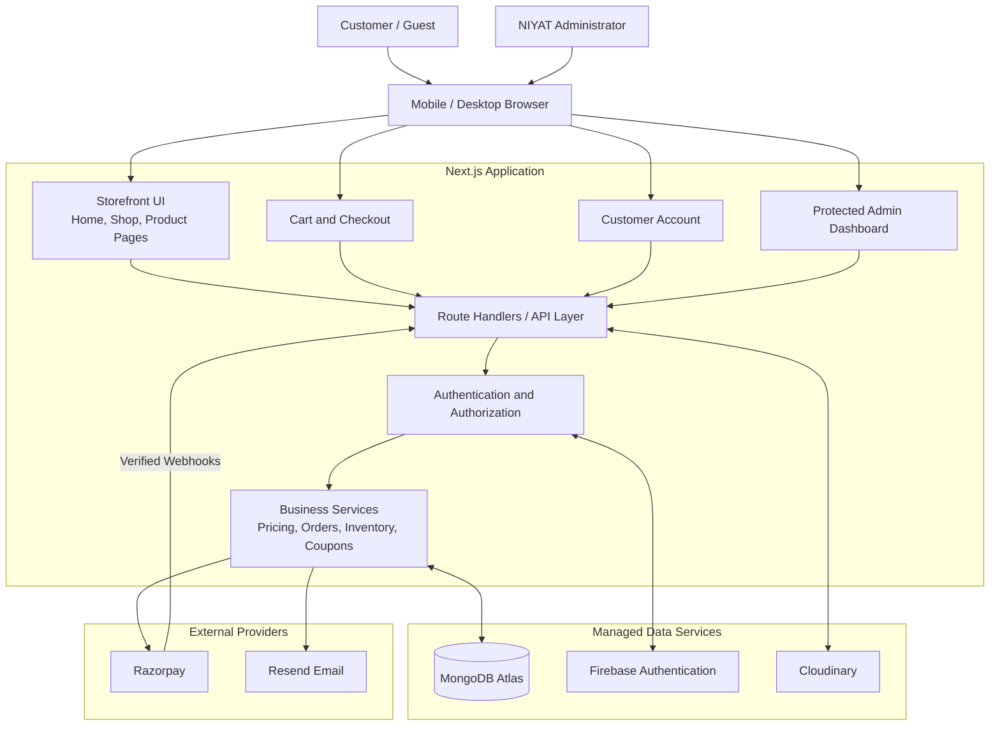
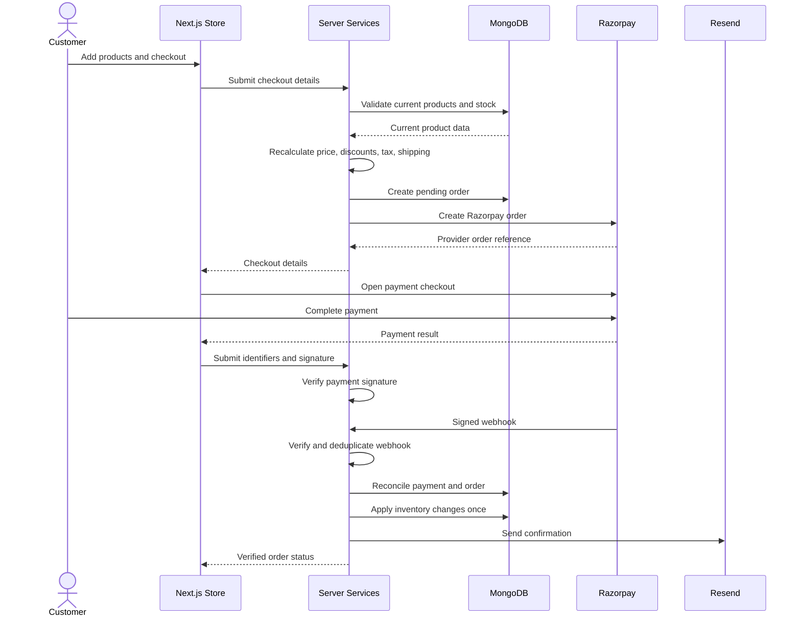
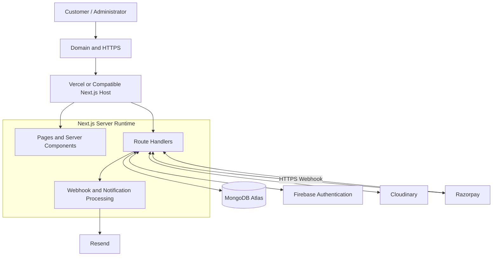

# NIYAT E-Commerce Platform — High-Level Design (HLD)

**Document Version:** 1.0  
**Document Status:** Architecture Specification  
**Date:** October 2026  
**Product:** NIYAT Premium Skincare E-Commerce Platform  
**Primary Market:** India  
**Currency:** INR

---

## 1. Overview

NIYAT is a full-stack skincare e-commerce application for selling six initial products:

1. Whitening Cream — 40 g
2. Face Wash — 100 g
3. Sunscreen — 50 g
4. Body Lotion — 200 g
5. Emergency Whitening Serum — 3 ml
6. Premium Face Serum — 15 ml

The platform will provide a customer-facing storefront, product catalog, cart, checkout, online payments, optional Cash on Delivery (COD), customer accounts, order tracking, inventory management, and a protected administrative dashboard.

### 1.1 Objectives

- Establish an official online sales channel for NIYAT.
- Present products with accurate descriptions and authentic product photography.
- Support secure online purchases and configurable COD.
- Provide product, inventory, order, customer, coupon, and content management.
- Improve organic product discovery through SEO.
- Maintain accurate payment, order, and inventory records.
- Support future growth without requiring an immediate migration to a separate backend.

### 1.2 Scope

**Included in the initial release**
- Responsive storefront and product pages.
- Search, filtering, sorting, and pagination.
- Cart, checkout, coupons, and shipping calculations.
- Guest checkout and Firebase customer authentication.
- Razorpay payments and webhook processing.
- Configurable COD.
- Customer profile, addresses, order history, and tracking.
- Product and inventory administration.
- Order, customer, banner, content, and coupon management.
- Cloudinary image uploads.
- Resend transactional email.
- Reports, CSV exports, invoices, SEO, and security controls.

**Potential future features**
- Native mobile applications.
- Multi-vendor marketplace.
- Subscriptions and loyalty points.
- AI skincare recommendations.
- Advanced courier integrations.
- Wholesale and distributor portals.
- Multilingual storefront.

---

## 2. Technology Stack

| Layer | Technology | Responsibility |
|---|---|---|
| Frontend | Next.js App Router | Storefront, product pages, cart, checkout, admin UI |
| Language | TypeScript | Type safety |
| UI | Tailwind CSS + shadcn/ui | Responsive interface |
| Server | Next.js Route Handlers and server-side services | APIs and business logic |
| Database | MongoDB Atlas | Products, orders, profiles, inventory, payments |
| ODM | Mongoose | Schemas, validation, indexes |
| Authentication | Firebase Authentication | Customer identity |
| Media storage | Cloudinary | Product photos and banners |
| Payments | Razorpay | Online payment processing |
| Email | Resend | Transactional emails |
| Hosting | Vercel or compatible platform | Application hosting |
| Monitoring | Hosting logs and error monitoring | Diagnostics and operational health |

A separate Express server is not required for the initial release. Keep server-side business logic modular so it can be separated later if necessary.

---

## 3. System Architecture



### Architecture principles

- The browser handles presentation and user interaction.
- The server is authoritative for pricing, stock, order creation, payment verification, and authorization.
- Public product pages may use server rendering for SEO.
- External provider callbacks must be authenticated before they can change business state.
- Database records, not client state, are authoritative for orders and payments.

---

## 4. Application Modules

### 4.1 Storefront
- Homepage and navigation.
- Product catalog and categories.
- Product detail pages and image gallery.
- Search, filtering, sorting, and pagination.
- SEO metadata and structured data.
- Promotional banners and featured collections.

### 4.2 Commerce
- Cart and wishlist.
- Checkout validation.
- Coupon validation.
- Shipping and tax calculation.
- Order creation and invoice generation.

### 4.3 Payments
- Razorpay order creation.
- Payment signature verification.
- Webhook verification and processing.
- Payment reconciliation.
- Refund workflow.

### 4.4 Inventory and fulfilment
- Stock levels and low-stock alerts.
- Inventory movement history.
- Order processing and shipment tracking.
- Cancellation and eligible stock restoration.

### 4.5 Customer accounts
- Firebase authentication.
- Profile and address management.
- Order history and tracking.
- Wishlist and eligible product reviews.

### 4.6 Administration
- Product and category management.
- Orders, customers, inventory, and payments.
- Coupons, banners, and content.
- Reports and CSV exports.
- Shipping, tax, and COD settings.
- Staff permissions and audit logs.

### 4.7 Notifications
- Order and payment confirmation.
- Shipment updates.
- Cancellation and refund updates.
- Email delivery tracking and safe retries.

---

## 5. User Roles

### Guest
Can browse published products, use a guest cart, and complete guest checkout. Cannot access another customer's information or administrative functions.

### Registered Customer
Can manage their profile and addresses, view their orders, track shipments, maintain a wishlist, and submit eligible verified-purchase reviews.

### Administrator
Can manage products, prices, inventory, orders, customers, coupons, banners, settings, reports, and authorized refunds.

### Staff
An optional restricted role with explicitly assigned permissions. Staff do not automatically receive access to payment credentials, administrator provisioning, or all customer data.

All roles must be enforced on the server. Public registration must never grant administrator privileges.

---

## 6. Product Catalog

The initial catalog includes:

| Product | Size | Suggested category |
|---|---|---|
| Whitening Cream | 40 g | Face Cream |
| Face Wash | 100 g | Facial Cleanser |
| Sunscreen | 50 g | Sun Protection |
| Body Lotion | 200 g | Body Care |
| Emergency Whitening Serum | 3 ml | Facial Serum |
| Premium Face Serum | 15 ml | Facial Serum |

Categories are suggestions and must be editable.

### Product fields
- Product ID, name, slug, SKU, and optional barcode.
- Short and full descriptions.
- Category and tags.
- Size or volume.
- Regular price and optional sale price.
- Product images and Cloudinary asset IDs.
- Ingredients, directions, warnings, and verified benefits.
- Verified specifications, including SPF/PA where applicable.
- Stock quantity and low-stock threshold.
- Draft, published, or archived status.
- Featured status.
- SEO title and meta description.
- Creation and update timestamps.

Do not invent prices, ingredients, SPF ratings, clinical results, certifications, endorsements, or guaranteed cosmetic outcomes. Keep products in draft until required information and authentic photographs are approved.

Prices must use integer paise or another explicitly defined precision-safe representation. Historical order prices must not change when catalog prices are edited.

---

## 7. Storefront Pages

### Public pages
1. Home
2. Shop All
3. Product Category
4. Product Details
5. Search Results
6. Cart
7. Checkout
8. Payment Result
9. Order Confirmation
10. Track Order
11. About Us
12. Contact Us
13. FAQ
14. Privacy Policy
15. Terms and Conditions
16. Shipping Policy
17. Return and Refund Policy
18. Cancellation Policy
19. 404 and error pages

### Customer pages
- Register, login, and password reset.
- Profile and address book.
- Order history and order details.
- Shipment tracking.
- Wishlist.
- Eligible review management.

### Admin pages
- Dashboard.
- Product and category management.
- Inventory and inventory history.
- Order management.
- Payment and refund records.
- Customer management.
- Coupon and banner management.
- Homepage and policy content management.
- Review moderation.
- Shipping, tax, and notification settings.
- Reports, exports, staff roles, audit logs, and site settings.

---

## 8. Core Shopping Requirements

### Homepage
- Configurable announcement bar.
- Brand navigation, search, account, wishlist, and cart.
- Hero section with authentic NIYAT photography.
- Featured products and categories.
- Brand introduction and product education.
- Bestsellers based on real order data.
- Genuine reviews when available.
- Newsletter signup and FAQ.
- Footer with contact details, social links, and policies.

### Product listing and details
- Search by product name.
- Category and price filters.
- Availability filter and sorting.
- Pagination or load-more.
- Product image gallery and zoom.
- Accurate price and stock information.
- Verified ingredients, usage, warnings, and specifications.
- Related products.
- SEO metadata and structured data.

### Cart
- Add, remove, and update quantities.
- Guest cart persistence where appropriate.
- Coupon application and removal.
- Subtotal, discount, shipping, tax, and total.
- Stock revalidation.
- Clear empty, loading, and error states.

The browser cart is not authoritative. The server must revalidate every item and recalculate every amount during checkout.

### Checkout
Collect:
- Customer name, email, and mobile number.
- Address lines, city, state, PIN code, and country.
- Optional billing address and order notes.
- Required purchase-term acceptance.
- Separate optional marketing consent.

Checkout must validate customer data, shipping availability, stock, coupons, and final charges before creating an order.

---

## 9. Payment Architecture

Razorpay is the proposed online payment gateway. Begin with test credentials and enable live payments only after merchant onboarding and production configuration.

### Payment workflow



### Payment security requirements
- Keep secret keys exclusively on the server.
- Verify payment signatures with the official Razorpay SDK.
- Verify webhook signatures against the original raw request body.
- Make event processing idempotent.
- Store unique provider references.
- Handle repeated and out-of-order events safely.
- Reconcile uncertain payment outcomes with the provider.
- Never trust the frontend callback alone as proof of payment.
- Never store card numbers or CVVs.
- Do not deduct stock more than once.

### Payment statuses
Created, Pending, Authorized where applicable, Captured/Paid, Failed, Cancelled, Refund Pending, Partially Refunded, and Refunded.

Payment status must be separate from fulfilment status.

### Cash on Delivery
COD must be configurable by the administrator, including enabled regions, order value limits, and payment collection tracking. A COD order must not be marked paid until collection is confirmed.

### Refunds
Authorized administrators can initiate eligible refunds. Store the amount, provider reference, status, and audit trail. Prevent duplicate refund requests and reconcile status with the payment provider.

---

## 10. Order and Fulfilment Management

Each order stores:
- Unique order number.
- Customer and address snapshots.
- Purchased product snapshots, SKU, unit price, quantity, and line totals.
- Discount, shipping, tax, and final total.
- Payment method and payment status.
- Fulfilment status.
- Shipment and tracking details.
- Status history and timestamps.

### Fulfilment statuses
- Pending Payment.
- Confirmed.
- Processing.
- Packed, optional.
- Shipped.
- Out for Delivery, optional.
- Delivered.
- Cancellation Requested.
- Cancelled.
- Return Requested, if supported.
- Returned, if applicable.

Payment and refund statuses remain independent.

Administrators can search and filter orders, view details, update eligible statuses, add tracking details, print invoices, export authorized records, and process eligible cancellations/refunds.

### Shipping
Configure:
- Delivery regions.
- Shipping fees.
- Free-shipping threshold.
- Optional weight/value-based rules.
- Estimated delivery text.
- COD restrictions.
- Processing times and policy content.

Manual courier tracking is sufficient for the initial release. Automated courier integration can be added later.

---

## 11. Inventory Management

Each product supports available stock, optional reserved stock, low-stock threshold, and stock history.

Administrators can add stock, make authorized adjustments with reasons, view movement history, and see low-stock alerts.

The system must:
- Validate stock at checkout.
- Prevent overselling through atomic updates or transactions.
- Prevent duplicate stock deductions.
- Restore stock for eligible cancellations according to the defined policy.
- Record all movements.
- Preserve historical inventory records.

The inventory reservation, release, and expiry policy must be finalized before production.

---

## 12. Admin Dashboard

### Dashboard metrics
- Total orders.
- Revenue from verified payments.
- Pending payments.
- Orders awaiting processing.
- Completed deliveries.
- Customer count.
- Low-stock alerts.
- Product sales summaries.
- Recent orders.

All metrics must be derived from real database records. Revenue calculations must define treatment of refunds, cancellations, discounts, taxes, and COD collections.

### Product and category management
Administrators can create, edit, publish, unpublish, archive, and manage product images, prices, descriptions, stock, categories, and SEO metadata.

### Coupons
Support fixed and percentage discounts, minimum order values, maximum discount limits, date windows, usage limits, per-customer limits, product/category restrictions, and active/inactive status.

### Content management
Manage hero banners, announcement bars, featured products, About Us, FAQ, contact information, footer links, and legal policies without code changes.

### Reports
Provide authorized reports for sales by date, product and category, payment method/status, order status, inventory, coupon usage, refunds, and permitted customer order history. Support CSV export with appropriate access controls.

---

## 13. Authentication and Customer Accounts

Use Firebase Authentication for:
- Email/password registration and login.
- Logout and password reset.
- Email verification where configured.
- Optional Google sign-in.

Verify Firebase ID tokens on the server using Firebase Admin SDK.

Customer features include profile management, saved addresses, order history, order details, shipment tracking, wishlist, and eligible verified-purchase reviews.

The backend must derive identity from the verified token, not a user ID supplied in the request body. Customers must only access their own records.

---

## 14. Cloudinary and Email

### Cloudinary
Use Cloudinary for product images, category images, and banners.

The server must authorize uploads or generate secure signatures. Validate file types and sizes, store asset identifiers and secure URLs, support image replacement/removal, and optimize delivery.

### Resend
Use Resend or an equivalent transactional provider for:
- Order confirmation.
- Payment confirmation.
- Shipment updates.
- Cancellation and refund updates.
- Optional welcome email.

Emails should use NIYAT branding, accurate order details, and configured support information. Email failures must not invalidate an order. Use safe retry and deduplication behavior.

Newsletter marketing consent must be separate from transactional communications.

---

## 15. Database Design

Use MongoDB Atlas with Mongoose.

### Main collections

| Collection | Purpose |
|---|---|
| Product | Catalog, prices, images, specifications, stock |
| Category | Product categorization |
| UserProfile | Firebase UID, profile and application role |
| Address | Customer addresses |
| Order | Order totals, snapshots, status and fulfilment |
| Payment | Provider references, payment attempts and status |
| Coupon | Discount rules and usage restrictions |
| InventoryMovement | Stock additions, deductions, and adjustments |
| Review | Product ratings, reviews, and moderation |
| Banner | Homepage and campaign banners |
| SiteSettings | Shipping, tax, currency and site settings |
| AuditLog | Privileged administrative actions |
| WebhookEvent | Provider event processing and deduplication |
| NewsletterSubscription | Consent and subscription status |
| Refund | Refund lifecycle, if maintained separately |
| Cart | Optional server-side cart persistence |

### Important data rules
- Unique product slugs, SKUs when present, order numbers, and appropriate provider references.
- Index common query fields such as customer, order date, status, and product slug.
- Store monetary values as integer paise.
- Preserve purchased item snapshots in orders.
- Validate references in application code; MongoDB does not automatically enforce relational foreign keys.
- Use transactions where supported and document deployment requirements.
- Never store Firebase passwords in MongoDB.

---

## 16. Technical Project Structure

Suggested Next.js App Router structure:

```text
src/
  app/
    (storefront)/
      page.tsx
      shop/
      products/[slug]/
      categories/[slug]/
      cart/
      checkout/
      about/
      contact/
    account/
      login/
      register/
      orders/
      orders/[orderNumber]/
      profile/
      addresses/
      wishlist/
    admin/
      dashboard/
      products/
      categories/
      orders/
      inventory/
      customers/
      coupons/
      banners/
      reviews/
      reports/
      settings/
    api/
      health/
      products/
      categories/
      banners/
      newsletter/
      checkout/
      orders/
      orders/track/
      payments/
      webhooks/
      me/
      admin/

  components/
    layout/
    navigation/
    products/
    cart/
    checkout/
    account/
    admin/
    forms/
    ui/

  lib/
    auth/
    db/
    payments/
    cloudinary/
    email/
    validation/
    security/
    pricing/
    shipping/

  models/
  services/
  schemas/
  types/
  tests/
    unit/
    integration/
    e2e/
```

Keep business logic in server-only services, separate from UI components. Validate API requests and return consistent response formats and HTTP status codes.

### Core service boundaries
- ProductService.
- PricingService.
- CheckoutService.
- OrderService.
- PaymentService.
- InventoryService.
- CouponService.
- ShippingService.
- WishlistService.
- ReviewService.
- NewsletterService.
- NotificationService.
- ReportService.

---

## 17. API Requirements

### Public APIs
- `GET /api/health`
- `GET /api/products`
- `GET /api/products/[slug]`
- `GET /api/categories`
- `GET /api/banners`
- `POST /api/newsletter`
- `GET /api/orders/track`

### Customer APIs
- `GET /api/me`
- `PATCH /api/me`
- `GET /api/me/addresses`
- `POST /api/me/addresses`
- `PATCH /api/me/addresses/[id]`
- `DELETE /api/me/addresses/[id]`
- `GET /api/me/orders`
- `GET /api/me/orders/[id]`
- `POST /api/orders/[id]/cancel-request`
- `GET /api/me/wishlist`
- `POST /api/me/wishlist`
- `DELETE /api/me/wishlist/[productId]`
- `POST /api/products/[id]/reviews`
- `GET /api/products/[id]/reviews`

### Checkout and payment APIs
- `POST /api/checkout/validate`
- `POST /api/orders`
- `POST /api/payments/razorpay/create-order`
- `POST /api/payments/razorpay/verify`
- `POST /api/webhooks/razorpay`

### Admin APIs
- `GET /api/admin/dashboard`
- `GET /api/admin/products`
- `POST /api/admin/products`
- `GET /api/admin/products/[id]`
- `PATCH /api/admin/products/[id]`
- `DELETE /api/admin/products/[id]`
- `GET /api/admin/orders`
- `GET /api/admin/orders/[id]`
- `PATCH /api/admin/orders/[id]/status`
- `GET /api/admin/customers`
- `GET /api/admin/inventory`
- `POST /api/admin/inventory/adjustments`
- `GET /api/admin/reports`
- `POST /api/admin/coupons`
- `PATCH /api/admin/coupons/[id]`
- `POST /api/admin/banners`
- `PATCH /api/admin/banners/[id]`
- `GET /api/admin/reviews`
- `PATCH /api/admin/reviews/[id]`
- `DELETE /api/admin/reviews/[id]`
- `GET /api/admin/settings`
- `PATCH /api/admin/settings`

Additional endpoints may be added for categories, refunds, staff roles, content, shipping, and audit logs. Every protected route must verify authentication, authorization, and resource ownership as applicable.

Additional endpoints may be added for categories, refunds, staff roles, content, shipping, and audit logs. Every protected route must verify authentication, authorization, and resource ownership as applicable.

---

## 18. SEO, Performance, and Accessibility

### SEO
- Server-render public product pages where appropriate.
- Unique titles and meta descriptions.
- Canonical URLs and Open Graph metadata.
- Product structured data using verified information.
- XML sitemap and `robots.txt`.
- Breadcrumbs and internal links.
- Descriptive image alt text.
- No indexing of unpublished products or private account pages.
- Google Search Console readiness.

Do not fabricate reviews, ratings, product claims, or prices.

### Performance
- Optimized responsive images.
- Appropriate caching and revalidation.
- Pagination and database indexes.
- Minimal unnecessary JavaScript.
- Lazy loading below the fold.
- Accurate stock and prices at checkout.

Target Core Web Vitals:
- LCP: 2.5 seconds or less.
- INP: 200 milliseconds or less.
- CLS: 0.1 or less.

Measure under representative production conditions.

### Accessibility
Use semantic HTML, keyboard navigation, visible focus indicators, accessible forms and dialogs, sufficient contrast, and meaningful labels.

---

## 19. Security and Privacy

### Application security
- Firebase token verification.
- Server-side role-based access control.
- Input validation and sanitization.
- Rate limiting and secure HTTP headers.
- Restricted CORS/origins.
- Safe error messages.
- Secure secret management.
- Audit logging.
- Least-privilege access.

### Payment security
- Server-only payment secrets.
- Signature and webhook verification.
- Idempotent processing.
- Reconciliation of uncertain outcomes.
- Server-authoritative totals.
- No storage of card numbers or CVVs.

### Privacy
- Collect only required data.
- Publish privacy and consumer policies.
- Restrict customer data access.
- Avoid sensitive data in logs.
- Define retention and deletion procedures.
- Review applicable Indian privacy, consumer-protection, e-commerce, tax, and cosmetic requirements before launch.

### Product claims
Do not invent ingredient lists, SPF/PA ratings, clinical results, endorsements, certifications, medical claims, or guaranteed whitening outcomes. Product content must be verified and approved by NIYAT.

---

## 20. Deployment Architecture



### Environment variables
Create a documented `.env.example` containing appropriate variables for:
- `MONGODB_URI`
- `NEXT_PUBLIC_FIREBASE_API_KEY`
- `NEXT_PUBLIC_FIREBASE_AUTH_DOMAIN`
- `NEXT_PUBLIC_FIREBASE_PROJECT_ID`
- Firebase Admin server credentials or workload identity configuration
- `CLOUDINARY_CLOUD_NAME`
- `CLOUDINARY_API_KEY`
- `CLOUDINARY_API_SECRET`
- `RAZORPAY_KEY_ID`
- `RAZORPAY_KEY_SECRET`
- `RAZORPAY_WEBHOOK_SECRET`
- Email provider API key and sender address
- Public site URL and server-side site URL
- Secure administrator provisioning configuration

Never commit real credentials. Private keys must not be exposed through public frontend environment variables.

### Environments
Maintain separate local development, staging/testing, and production environments. Use separate credentials and appropriate database configuration.

### Production checklist
- Domain and HTTPS configured.
- Firebase authorized domains configured.
- Razorpay live credentials and webhook configured.
- Cloudinary uploads verified.
- Email sending domain configured.
- Database backups and restoration tested.
- Admin access reviewed.
- Product information and legal policies approved.
- Mobile and checkout tests passed.
- SEO metadata and sitemap validated.
- Monitoring and error reporting configured.

---

## 21. Failure Handling

| Failure | Required behavior |
|---|---|
| MongoDB unavailable | Return a controlled error; never fabricate success |
| Payment cancelled | Preserve appropriate order state and allow safe retry |
| Payment uncertain | Reconcile with Razorpay before finalizing |
| Duplicate webhook | Prevent duplicate business effects |
| Image upload failure | Keep draft and show error |
| Email failure | Preserve order and safely retry notification |
| Stock changes during checkout | Revalidate and prevent overselling |
| Unauthorized admin request | Reject and log relevant security event |
| Deployment failure | Roll back and follow recovery procedure |

Email delivery does not determine payment success. Database order/payment records and verified provider events remain authoritative.

---

## 22. Testing Requirements

### Unit tests
- Pricing and discount calculations.
- Tax and shipping calculations.
- Coupon eligibility.
- Product validation.
- Order state transitions.
- Inventory adjustment rules.
- Payment signature verification.

### Integration tests
- MongoDB operations.
- Firebase token verification.
- Admin access restrictions.
- Checkout validation.
- Order creation.
- Razorpay test integration.
- Webhook verification and deduplication.
- Inventory consistency.
- Cancellation and refund handling.

### End-to-end tests
1. Browse a product.
2. Add it to cart and change quantity.
3. Apply a coupon.
4. Submit shipping details.
5. Complete a Razorpay test payment.
6. Verify order confirmation.
7. View the order in the customer account.
8. Process the order through admin.
9. Update tracking.
10. Verify stock and totals.
11. Test failed/cancelled payments.
12. Test unauthorized admin access.
13. Test out-of-stock products.
14. Test duplicate callbacks and webhooks.

Do not launch while critical checkout, payment, authorization, or inventory tests fail.

---

## 23. Monitoring, Backups, and Recovery

Monitor:
- Application errors.
- API availability.
- Database connectivity.
- Payment verification failures.
- Webhook failures.
- Email delivery errors.
- Inventory consistency.

Use structured logs without passwords, tokens, secrets, or unnecessary personal information.

Configure automated database backups, appropriate retention, restricted backup access, documented restoration procedures, and a tested recovery process.

For substantial asynchronous workloads, introduce a durable queue and worker service instead of relying on long-running web requests.

---

## 24. Development Phases

### Phase 1 — Foundation
Set up Next.js, TypeScript, UI components, environment configuration, MongoDB, Firebase, and the design system.

**Deliverable:** Running application foundation.

### Phase 2 — Storefront
Build the homepage, navigation, shop, categories, product details, responsive design, and SEO.

**Deliverable:** Functional public storefront.

### Phase 3 — Customer Shopping
Implement authentication, cart, wishlist, addresses, checkout, and server-side price/stock validation.

**Deliverable:** Shopping flow through order creation.

### Phase 4 — Payments and Orders
Implement Razorpay test mode, signature verification, webhooks, payment states, COD, order confirmation, and email notifications.

**Deliverable:** Verified test-payment and order lifecycle.

### Phase 5 — Admin Dashboard
Build product, category, image, inventory, order, coupon, content, and report management.

**Deliverable:** Functional administration system.

### Phase 6 — Quality and Security
Run automated tests, authorization reviews, payment tests, inventory concurrency tests, accessibility checks, and performance optimization.

**Deliverable:** Release candidate.

### Phase 7 — Production Launch
Configure domain, live credentials, email, backups, monitoring, legal policies, and final acceptance tests.

**Deliverable:** Production-ready application.

---

## 25. Risks and Mitigation

| Risk | Mitigation |
|---|---|
| Incorrect product claims | Require verified information and approval before publication |
| Duplicate payment events | Idempotent processing and provider reconciliation |
| Inventory race conditions | Atomic updates or transactions and concurrency testing |
| Unauthorized admin access | Server-side roles, secure provisioning, audit logs |
| Incomplete product imagery | Keep products unpublished until approved photos are available |
| Stale cached prices | Revalidate content and recalculate prices at checkout |
| Missing business policies | Keep settings configurable and block launch until approved |
| Hosting incompatibility | Confirm server execution, webhook, and database requirements |

---

## 26. Open Business Decisions

| Decision | Status |
|---|---|
| Prices for all six products | Pending |
| Verified ingredients and specifications | Pending |
| Approved product photographs | Partially available |
| Official logo and brand assets | To confirm |
| Official email and telephone | Pending |
| Business registration and address details | Pending |
| Shipping coverage and fees | To confirm |
| Free-shipping threshold | To confirm |
| COD availability | To confirm |
| Return/refund/cancellation policies | To approve |
| Tax and invoice configuration | To confirm |
| Razorpay merchant onboarding | To complete |
| Email provider configuration | To complete |
| Domain and hosting | To confirm |
| Admin users and permissions | To configure |
| Analytics and advertising | Optional |
| WhatsApp customer communication | Optional |

Do not invent unconfirmed business details. Keep them configurable until NIYAT approves them.

---

## 27. Final Architecture Decisions

1. Use one Next.js App Router application for storefront and backend.
2. Use MongoDB Atlas as the primary database.
3. Use Firebase Authentication for identity and server-side authorization.
4. Use Razorpay for online payments and configurable COD.
5. Use Cloudinary for product images.
6. Use Resend for transactional email.
7. Separate payment status from fulfilment status.
8. Keep prices, authorization, payment verification, and inventory operations server-authoritative.
9. Preserve historical order snapshots and audit-sensitive operations.
10. Introduce separate backend services or workers only when scale or operational requirements justify them.

This HLD establishes the system architecture, modules, integrations, data responsibilities, major workflows, and non-functional requirements. The next engineering document should be the Low-Level Design (LLD), specifying detailed schemas, API contracts, state transitions, validation rules, and implementation-level security controls.

**End of HLD — NIYAT E-Commerce Platform, Version 1.0.**
