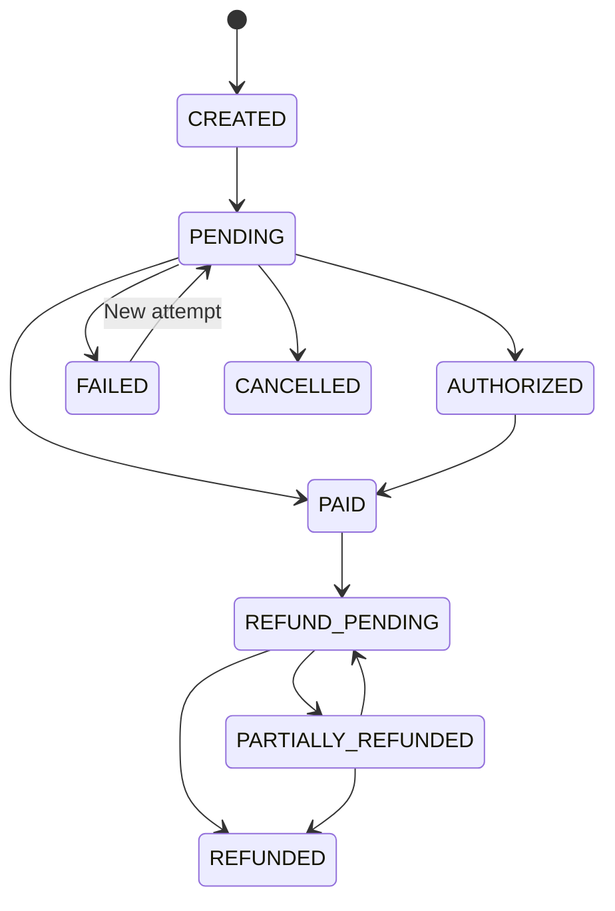
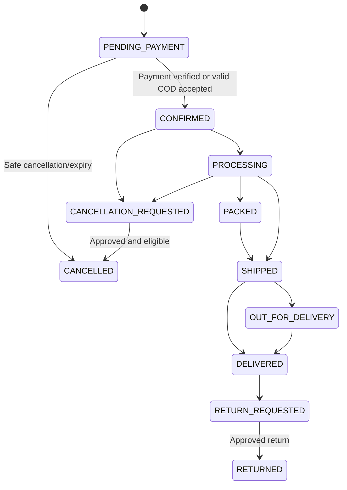

# NIYAT E-Commerce Platform — Low-Level Design (LLD)

**Document Version:** 1.0  
**Status:** Implementation Specification  
**Date:** October 2026  
**Related Documents:** NIYAT PRD v1.0, NIYAT HLD v1.0  
**Application:** NIYAT Premium Skincare E-Commerce Platform

---

## 1. Purpose

This document translates the NIYAT HLD into implementation-level specifications. It defines application modules, TypeScript contracts, Mongoose schemas, indexes, API request/response contracts, authorization rules, payment and order state transitions, validation, error handling, testing, and deployment requirements.

The implementation uses a single Next.js App Router application with server-side services. It does not require a separate Express server for the initial release.

## 2. Fixed Technology Decisions

- Next.js App Router and TypeScript.
- Tailwind CSS and shadcn/ui.
- MongoDB Atlas and Mongoose.
- Firebase Authentication, verified on the server using Firebase Admin SDK.
- Razorpay for online payments.
- Cloudinary for product and banner images.
- Resend for transactional email.
- Vercel or a compatible Next.js hosting platform.
- Unit, integration, and end-to-end testing.

The server is authoritative for identity, authorization, prices, coupons, taxes, shipping, inventory, orders, and payment state.

---

## 3. Application Structure

```text
src/
  app/
    (storefront)/
      page.tsx
      shop/page.tsx
      products/[slug]/page.tsx
      categories/[slug]/page.tsx
      cart/page.tsx
      checkout/page.tsx
      order-confirmation/[orderNumber]/page.tsx
    account/
      login/page.tsx
      register/page.tsx
      orders/page.tsx
      orders/[orderNumber]/page.tsx
      profile/page.tsx
      addresses/page.tsx
      wishlist/page.tsx
    admin/
      layout.tsx
      dashboard/page.tsx
      products/page.tsx
      products/new/page.tsx
      products/[id]/page.tsx
      orders/page.tsx
      orders/[id]/page.tsx
      inventory/page.tsx
      coupons/page.tsx
      banners/page.tsx
      reviews/page.tsx
      customers/page.tsx
      reports/page.tsx
      settings/page.tsx
    api/
      health/route.ts
      products/route.ts
      products/[slug]/route.ts
      categories/route.ts
      checkout/validate/route.ts
      newsletter/route.ts
      orders/route.ts
      orders/track/route.ts
      orders/[id]/route.ts
      payments/razorpay/create-order/route.ts
      payments/razorpay/verify/route.ts
      webhooks/razorpay/route.ts
      me/route.ts
      me/addresses/route.ts
      me/orders/route.ts
      me/wishlist/route.ts
      me/wishlist/[productId]/route.ts
      products/[productId]/reviews/route.ts
      admin/products/route.ts
      admin/products/[id]/route.ts
      admin/orders/route.ts
      admin/orders/[id]/route.ts
      admin/reviews/route.ts
      admin/reviews/[id]/route.ts
      admin/inventory/adjustments/route.ts
      admin/coupons/route.ts
      admin/banners/route.ts
      admin/reports/route.ts
      admin/settings/route.ts
  components/
    ui/
    layout/
    products/
    cart/
    checkout/
    account/
    admin/
  lib/
    auth/
      firebase-admin.ts
      require-user.ts
      require-role.ts
      session-cookie.ts
    db/
      mongoose.ts
    config/
      env.ts
    validation/
    security/
    payments/
      razorpay.ts
    cloudinary/
    email/
  models/
    Product.ts
    Category.ts
    UserProfile.ts
    Address.ts
    Cart.ts
    Order.ts
    Payment.ts
    Coupon.ts
    InventoryMovement.ts
    Review.ts
    Banner.ts
    SiteSettings.ts
    NewsletterSubscription.ts
    WebhookEvent.ts
    AuditLog.ts
    Refund.ts
  services/
    product.service.ts
    pricing.service.ts
    checkout.service.ts
    order.service.ts
    payment.service.ts
    inventory.service.ts
    coupon.service.ts
    shipping.service.ts
    wishlist.service.ts
    review.service.ts
    newsletter.service.ts
    notification.service.ts
    report.service.ts
  schemas/
    product.schema.ts
    checkout.schema.ts
    order.schema.ts
    coupon.schema.ts
  types/
    api.ts
    domain.ts
  tests/
    unit/
    integration/
    e2e/
```

Implementation may adjust filenames, but business logic must remain modular and server-only. Do not import secret-bearing modules into Client Components.

---

## 4. Domain Types and Constants

### 4.1 Common types

```ts
type CurrencyCode = "INR";

type ProductStatus = "DRAFT" | "PUBLISHED" | "ARCHIVED";

type UserRole = "CUSTOMER" | "STAFF" | "ADMIN";

type PaymentMethod = "RAZORPAY" | "COD";

type PaymentStatus =
  | "CREATED"
  | "PENDING"
  | "AUTHORIZED"
  | "PAID"
  | "FAILED"
  | "CANCELLED"
  | "REFUND_PENDING"
  | "PARTIALLY_REFUNDED"
  | "REFUNDED";

type FulfilmentStatus =
  | "PENDING_PAYMENT"
  | "CONFIRMED"
  | "PROCESSING"
  | "PACKED"
  | "SHIPPED"
  | "OUT_FOR_DELIVERY"
  | "DELIVERED"
  | "CANCELLATION_REQUESTED"
  | "CANCELLED"
  | "RETURN_REQUESTED"
  | "RETURNED";

type CouponType = "FIXED" | "PERCENTAGE";
```

Store money as integer paise. For example, ₹199.00 is `19900`. Do not use JavaScript floating-point values as authoritative money amounts.

### 4.2 Initial catalog seed

Seed the six products as drafts unless NIYAT has provided and approved their actual price, photographs, and required product information.

| Product | Size | Initial status |
|---|---|---|
| Whitening Cream | 40 g | Draft until approved |
| Face Wash | 100 g | Draft until approved |
| Sunscreen | 50 g | Draft until approved |
| Body Lotion | 200 g | Draft until approved |
| Emergency Whitening Serum | 3 ml | Draft until approved |
| Premium Face Serum | 15 ml | Draft until approved |

Do not invent prices, ingredients, SPF/PA ratings, certifications, reviews, or product efficacy claims.

---

## 5. Mongoose Data Models

The following specifications define the minimum important fields. Add standard `createdAt` and `updatedAt` timestamps to mutable models. Validate every write on the server and use database indexes for uniqueness and query performance.

### 5.1 Product

```ts
interface ProductDocument {
  name: string;
  slug: string;
  sku: string;
  barcode?: string;
  shortDescription?: string;
  description?: string;
  categoryId: Types.ObjectId;
  sizeLabel: string; // e.g. "40 g", "15 ml"
  regularPricePaise: number;
  salePricePaise?: number | null;
  currency: "INR";
  images: Array<{
    url: string;
    publicId: string;
    alt: string;
    sortOrder: number;
  }>;
  ingredients?: string[];
  directions?: string;
  warnings?: string;
  verifiedBenefits?: string[];
  specifications?: Record<string, string>;
  stockQuantity: number;
  lowStockThreshold: number;
  status: "DRAFT" | "PUBLISHED" | "ARCHIVED";
  isFeatured: boolean;
  tags: string[];
  seo: {
    title?: string;
    description?: string;
  };
}
```

Validation:
- `name`, `slug`, `sku`, `categoryId`, `sizeLabel`, and `regularPricePaise` are required.
- Prices and stock quantities must be non-negative integers.
- If a sale price exists, it must be non-negative and lower than the regular price.
- Slugs are normalized and unique.
- Only approved images can be attached to a published product.
- Only verified information may be entered into claims/specification fields.

Indexes:
- Unique `{ slug: 1 }`.
- Unique `{ sku: 1 }`.
- `{ status: 1, categoryId: 1 }`.
- `{ status: 1, isFeatured: 1 }`.
- Text/search index only if its behavior is tested and suitable for the selected search implementation.

### 5.2 Category

```ts
interface CategoryDocument {
  name: string;
  slug: string;
  description?: string;
  image?: { url: string; publicId: string; alt: string };
  status: "ACTIVE" | "ARCHIVED";
  seo?: { title?: string; description?: string };
}
```

Indexes:
- Unique `{ slug: 1 }`.
- `{ status: 1, name: 1 }`.

Do not archive or delete a category in a way that breaks historical orders. Products must be reassigned or explicitly archived.

### 5.3 UserProfile

Firebase is the identity provider; this collection stores application profile data.

```ts
interface UserProfileDocument {
  firebaseUid: string;
  name: string;
  email?: string;
  phone?: string;
  role: "CUSTOMER" | "STAFF" | "ADMIN";
  status: "ACTIVE" | "DISABLED";
  wishlist: Types.ObjectId[]; // Array of saved Product ObjectIds
  communicationPreferences?: {
    marketingEmail: boolean;
  };
}
```

Indexes:
- Unique `{ firebaseUid: 1 }`.
- Optional normalized email index, with a deliberate policy for missing values.
- `{ role: 1, status: 1 }`.

Never store passwords or Firebase authentication secrets in this collection. Role changes must use a trusted administrative process.

### 5.4 Address

```ts
interface AddressDocument {
  userId: Types.ObjectId;
  recipientName: string;
  phone: string;
  addressLine1: string;
  addressLine2?: string;
  city: string;
  state: string;
  postalCode: string;
  country: "IN";
  isDefault: boolean;
}
```

Indexes:
- `{ userId: 1, isDefault: 1 }`.

Validate ownership on every read, update, or delete. Orders must store immutable address snapshots so later address changes do not alter prior orders.

### 5.5 Order

```ts
interface OrderItemSnapshot {
  productId: Types.ObjectId;
  productName: string;
  sku: string;
  sizeLabel: string;
  imageUrl?: string;
  unitPricePaise: number;
  quantity: number;
  discountPaise: number;
  lineTotalPaise: number;
}

interface OrderDocument {
  orderNumber: string;
  userId?: Types.ObjectId;
  customer: {
    name: string;
    email?: string;
    phone: string;
  };
  items: OrderItemSnapshot[];
  shippingAddress: {
    recipientName: string;
    phone: string;
    addressLine1: string;
    addressLine2?: string;
    city: string;
    state: string;
    postalCode: string;
    country: "IN";
  };
  billingAddress?: Record<string, string>;
  subtotalPaise: number;
  discountPaise: number;
  shippingPaise: number;
  taxPaise: number;
  totalPaise: number;
  currency: "INR";
  coupon?: {
    code: string;
    discountPaise: number;
  };
  paymentMethod: "RAZORPAY" | "COD";
  paymentStatus: PaymentStatus;
  fulfilmentStatus: FulfilmentStatus;
  stockAppliedAt?: Date;
  cancellationReason?: string;
  shipment?: {
    carrier?: string;
    trackingNumber?: string;
    trackingUrl?: string;
    shippedAt?: Date;
    deliveredAt?: Date;
  };
  statusHistory: Array<{
    type: "PAYMENT" | "FULFILMENT";
    from?: string;
    to: string;
    actorType: "SYSTEM" | "CUSTOMER" | "ADMIN" | "WEBHOOK";
    actorId?: string;
    reason?: string;
    at: Date;
  }>;
}
```

Indexes:
- Unique `{ orderNumber: 1 }`.
- `{ userId: 1, createdAt: -1 }`.
- `{ paymentStatus: 1, createdAt: -1 }`.
- `{ fulfilmentStatus: 1, createdAt: -1 }`.
- `{ "customer.phone": 1, createdAt: -1 }`, subject to privacy and query requirements.

Do not allow arbitrary client updates to payment status, fulfilment status, totals, or status history. Order snapshots are immutable after creation except for explicitly controlled operational fields.

### 5.6 Payment

```ts
interface PaymentDocument {
  orderId: Types.ObjectId;
  provider: "RAZORPAY" | "COD";
  providerOrderId?: string;
  providerPaymentId?: string;
  amountPaise: number;
  currency: "INR";
  status: PaymentStatus;
  signatureVerified?: boolean;
  failureCode?: string;
  failureDescription?: string;
  paidAt?: Date;
  refundedPaise: number;
}
```

Indexes:
- `{ orderId: 1, createdAt: -1 }`.
- Unique sparse `{ providerPaymentId: 1 }`.
- Unique sparse `{ providerOrderId: 1 }` where provider semantics guarantee uniqueness.

One order may have multiple payment attempts. Only verified provider results may mark a Razorpay payment paid.

### 5.7 Coupon

```ts
interface CouponDocument {
  code: string;
  type: "FIXED" | "PERCENTAGE";
  value: number;
  minimumOrderPaise: number;
  maximumDiscountPaise?: number;
  startsAt: Date;
  expiresAt: Date;
  usageLimit?: number;
  perCustomerLimit?: number;
  applicableProductIds?: Types.ObjectId[];
  applicableCategoryIds?: Types.ObjectId[];
  usedCount: number;
  status: "ACTIVE" | "INACTIVE";
}
```

Indexes:
- Unique normalized `{ code: 1 }`.
- `{ status: 1, startsAt: 1, expiresAt: 1 }`.

Coupon use counts must be updated atomically or derived from authoritative order records. Prevent concurrent checkouts from exceeding usage limits.

### 5.8 InventoryMovement

```ts
interface InventoryMovementDocument {
  productId: Types.ObjectId;
  quantityChange: number;
  type: "RESTOCK" | "SALE" | "CANCELLATION" | "RETURN" | "ADJUSTMENT";
  reason: string;
  orderId?: Types.ObjectId;
  actorType: "SYSTEM" | "ADMIN";
  actorId?: string;
  idempotencyKey: string;
}
```

Indexes:
- `{ productId: 1, createdAt: -1 }`.
- Unique `{ idempotencyKey: 1 }`.

All inventory changes must create a movement record and update product stock through a controlled service.

### 5.9 Review

Fields:
- `productId`, `userId`, `orderId`.
- `rating` integer from 1 to 5.
- `reviewText`.
- `verificationStatus`.
- `moderationStatus`.
- timestamps.

Indexes:
- `{ productId: 1, moderationStatus: 1, createdAt: -1 }`.
- A suitable uniqueness rule preventing duplicate reviews for the same eligible product/order/customer.

Only approved reviews are public.

### 5.10 Banner and SiteSettings

Banner fields:
- title, image URL, Cloudinary public ID, alt text.
- optional target URL.
- placement, start/end times, sort order, active status.

SiteSettings fields:
- currency.
- shipping rules.
- free-shipping threshold.
- tax configuration.
- COD enabled and restrictions.
- support contact details.
- announcement bar.
- configurable operational settings.

Never store payment secrets in publicly readable settings.

### 5.11 WebhookEvent, Refund, AuditLog, NewsletterSubscription

**NewsletterSubscription**
- `email`: string, lowercase, trimmed.
- `status`: "ACTIVE" | "UNSUBSCRIBED".
- `source`: "STOREFRONT_FOOTER" | "CHECKOUT_OPTIN" | "ADMIN".
- `subscribedAt`: Date.
- `unsubscribedAt`: optional Date.
- Unique index on normalized `{ email: 1 }`.

**WebhookEvent**
- provider, event ID, event type, received time, processing status, processed time, error code.
- Unique index on provider + event ID.

**Refund**
- order ID, payment ID, provider refund ID, amount paise, status, reason, requested by, timestamps.
- Unique provider refund ID where available.

**AuditLog**
- actor ID and role, action, resource type and ID, safe before/after summary, request correlation ID, timestamp.
- Never log passwords, tokens, payment secrets, or unnecessary personal data.

---

## 6. API Contract Conventions

### 6.1 Success response

```json
{
  "success": true,
  "data": {},
  "meta": {}
}
```

### 6.2 Error response

```json
{
  "success": false,
  "error": {
    "code": "VALIDATION_ERROR",
    "message": "Please check the submitted information.",
    "requestId": "correlation-id"
  }
}
```

Do not expose stack traces, secrets, internal database details, or sensitive provider responses to clients.

### 6.3 Common HTTP status codes

- `200 OK`: successful read or update.
- `201 Created`: resource created.
- `400 Bad Request`: invalid input.
- `401 Unauthorized`: authentication missing or invalid.
- `403 Forbidden`: authenticated but not permitted.
- `404 Not Found`: resource unavailable or not visible.
- `409 Conflict`: stock conflict, duplicate action, or invalid state transition.
- `422 Unprocessable Entity`: semantically invalid business input.
- `429 Too Many Requests`: rate limit exceeded.
- `500 Internal Server Error`: unexpected failure.
- `503 Service Unavailable`: temporary dependency failure.

All list endpoints should use bounded pagination, for example `page` and `limit`, with a server-enforced maximum limit.

---

## 7. API Specifications

### 7.1 Public products

`GET /api/products?page=1&limit=12&category=face-care&sort=price_asc&q=cream`

Query parameters:
- `page`: positive integer.
- `limit`: bounded positive integer.
- `category`: optional category slug.
- `sort`: `newest`, `price_asc`, `price_desc`, or supported popularity sort.
- `q`: optional search term.
- `inStock`: optional boolean.

Only published products are returned. Do not return private inventory/audit fields.

Example response:

```json
{
  "success": true,
  "data": {
    "items": [
      {
        "id": "product-id",
        "name": "Whitening Cream",
        "slug": "whitening-cream",
        "sizeLabel": "40 g",
        "pricePaise": 0,
        "currency": "INR",
        "imageUrl": null,
        "inStock": false
      }
    ],
    "page": 1,
    "limit": 12,
    "total": 0
  }
}
```

This is a shape example only; actual prices and inventory must come from approved database records. Draft products must never be exposed by public APIs.

### 7.2 Product details

`GET /api/products/[slug]`

Returns published product fields, images, verified specifications, availability, and approved reviews. Return 404 for drafts, archived products, or inaccessible slugs.

### 7.3 Checkout validation

`POST /api/checkout/validate`

Request:

```json
{
  "items": [
    { "productId": "product-id", "quantity": 1 }
  ],
  "couponCode": "OPTIONAL-CODE",
  "shippingAddress": {
    "recipientName": "Customer",
    "phone": "9000000000",
    "addressLine1": "Address",
    "city": "City",
    "state": "State",
    "postalCode": "000000",
    "country": "IN"
  },
  "paymentMethod": "RAZORPAY"
}
```

Server actions:
1. Validate item count and quantities.
2. Load products from the database.
3. Verify products are published and purchasable.
4. Validate stock.
5. Recalculate prices.
6. Validate coupon and usage limits.
7. Calculate shipping and applicable tax.
8. Return a quote summary.

The validation response is informational. The server must repeat authoritative validation during order creation.

### 7.4 Create order

`POST /api/orders`

Request contains checkout details and product IDs/quantities only. The client must not submit authoritative unit prices, discounts, tax, shipping, or total.

Response:
- Order ID and order number.
- Payment method.
- Current order/payment status.
- For Razorpay, an instruction to create or continue a payment attempt through the dedicated payment endpoint.

Use an idempotency key for order submission. Store and enforce it server-side so retries do not create duplicate orders.

### 7.5 Create Razorpay order

`POST /api/payments/razorpay/create-order`

Request:

```json
{
  "orderId": "order-id"
}
```

Server must:
- Verify the order belongs to the customer, or is a valid guest checkout session.
- Verify the order is eligible for payment.
- Reconcile current payment state.
- Create a Razorpay order for the authoritative amount.
- Persist provider order reference and payment attempt.
- Return only the public key ID, provider order ID, amount paise, currency, and safe checkout details.

Never return the Razorpay secret key.

### 7.6 Verify Razorpay payment

`POST /api/payments/razorpay/verify`

Request:

```json
{
  "orderId": "order-id",
  "razorpay_order_id": "provider-order-id",
  "razorpay_payment_id": "provider-payment-id",
  "razorpay_signature": "provider-signature"
}
```

Server must:
- Verify the order/payment attempt relationship.
- Verify the signature with the official SDK and server-side secret.
- Ensure amount and currency match the expected order.
- Make processing idempotent.
- Update payment/order state only when supported by verified provider status.
- Return the current verified state.

The webhook remains an independent authoritative reconciliation mechanism.

### 7.7 Razorpay webhook

`POST /api/webhooks/razorpay`

Requirements:
- Read the raw request body.
- Verify the webhook signature.
- Deduplicate using the provider event ID.
- Persist event receipt before applying business effects.
- Process event with an idempotent service.
- Return a successful response for safely recognized duplicate events.
- Use retryable processing for transient failures.
- Do not trust client-supplied event data without signature verification.

### 7.8 Customer APIs

- `GET /api/me`
- `PATCH /api/me`
- `GET /api/me/addresses`
- `POST /api/me/addresses`
- `PATCH /api/me/addresses/[id]`
- `DELETE /api/me/addresses/[id]`
- `GET /api/me/orders?page=1&limit=10`
- `GET /api/me/orders/[id]`
- `POST /api/orders/[id]/cancel-request`
- `POST /api/products/[id]/reviews`

Every customer endpoint must enforce resource ownership. Guest order lookup, if supported, must use an unguessable, time-limited access token or another secure verification method, not just an order number.

### 7.9 Admin APIs

- `GET /api/admin/dashboard`
- `GET /api/admin/products`
- `POST /api/admin/products`
- `GET /api/admin/products/[id]`
- `PATCH /api/admin/products/[id]`
- `DELETE /api/admin/products/[id]`
- `GET /api/admin/orders`
- `GET /api/admin/orders/[id]`
- `PATCH /api/admin/orders/[id]/status`
- `GET /api/admin/customers`
- `GET /api/admin/inventory`
- `POST /api/admin/inventory/adjustments`
- `GET /api/admin/reports`
- `POST /api/admin/coupons`
- `PATCH /api/admin/coupons/[id]`
- `POST /api/admin/banners`
- `PATCH /api/admin/banners/[id]`
- `GET /api/admin/settings`
- `PATCH /api/admin/settings`

All admin endpoints must call server-side authentication and permission checks. Destructive operations should archive records where historical references exist.

---

## 8. Validation Rules

Use a schema validator such as Zod at every API boundary.

### Product
- Name: required, trimmed, bounded length.
- Slug: normalized lowercase URL-safe format.
- SKU: required and unique.
- Price: non-negative integer paise.
- Sale price: lower than regular price.
- Quantity: non-negative integer.
- Image URL/public ID: must originate from authorized upload records.
- Published product: must satisfy required publication checks.

### Checkout
- Items: non-empty and bounded count.
- Product IDs: valid identifiers.
- Quantity: positive integer with a configured maximum.
- Phone: validate accepted Indian phone format.
- PIN code: validate six-digit Indian PIN when shipping within India.
- Address: required fields and bounded lengths.
- Coupon: normalized code and server-side eligibility check.
- Total: calculated on server only.

### Coupon
- Code normalized to uppercase or a documented canonical format.
- Discount value within valid bounds.
- Percentage capped at the configured maximum, normally no more than 100%.
- Expiry after start time.
- Usage limits positive where provided.

### Admin inputs
- Validate status transitions.
- Require reason for manual inventory adjustments and sensitive operations.
- Reject fields that are not editable by the current role.
- Do not allow mass assignment of role, payment status, totals, or audit fields.

---

## 9. Service Layer Contracts

### ProductService
- `listPublishedProducts(filters)`
- `getPublishedProductBySlug(slug)`
- `createProduct(input, actor)`
- `updateProduct(id, input, actor)`
- `archiveProduct(id, actor)`

### PricingService
- `calculateSubtotal(items, products)`
- `calculateDiscount(coupon, eligibleItems)`
- `calculateTax(taxConfig, taxableAmount)`
- `calculateOrderTotal(quote)`

All money calculations use integer paise and a documented rounding policy.

### CheckoutService
- `validateCheckout(input, identity)`
- `createPendingOrder(input, identity, idempotencyKey)`
- `revalidateOrderBeforePayment(orderId)`

### OrderService
- `getOrderForCustomer(orderId, identity)`
- `listCustomerOrders(identity, pagination)`
- `transitionFulfilmentStatus(orderId, nextStatus, actor)`
- `requestCancellation(orderId, identity, reason)`

### PaymentService
- `createRazorpayOrder(orderId, identity)`
- `verifyRazorpayPayment(input)`
- `processVerifiedWebhook(event)`
- `reconcilePayment(orderId)`
- `initiateRefund(orderId, amountPaise, actor)`

### InventoryService
- `reserveStock(orderId)` if reservation is enabled.
- `applySaleDeduction(orderId, idempotencyKey)`.
- `releaseReservation(orderId, idempotencyKey)`.
- `adjustStock(productId, quantityChange, reason, actor)`.
- `restoreEligibleStock(orderId, idempotencyKey)`.

### CouponService
- `validateCoupon(code, cart, customerIdentity)`
- `recordCouponRedemption(orderId)`.

### ShippingService
- `calculateShipping(address, items, subtotalPaise)`
- `isRegionSupported(address)`
- `getEstimatedDelivery(address)` when configured.

### WishlistService
- `getWishlist(userId)`
- `addToWishlist(userId, productId)`
- `removeFromWishlist(userId, productId)`

### ReviewService
- `submitReview(input, userId)` (verifies delivered purchase eligibility)
- `listApprovedReviews(productId, pagination)`
- `listReviewsForModeration(filters, pagination)`
- `moderateReview(reviewId, status, actor, note)`
- `deleteReview(reviewId, actor)`

### NewsletterService
- `subscribe(email, source)`
- `unsubscribe(email)`

### NotificationService
- `sendOrderConfirmation(orderId)`
- `sendShipmentUpdate(orderId)`
- `sendCancellationUpdate(orderId)`
- `sendRefundUpdate(refundId)`

Notifications should be triggered after committed business state changes. Use a durable queue/outbox pattern if delivery reliability requires it.

### ReportService
- `getDashboardMetrics(range)`
- `getSalesReport(filters)`
- `getInventoryReport(filters)`
- `exportOrders(filters, actor)`

Reports must use defined revenue semantics and permission-controlled access.

---

## 10. Order and Payment State Machines

### 10.1 Payment state



Only verified provider information can move Razorpay payment state to paid or refunded. Do not allow arbitrary client transitions.

### 10.2 Fulfilment state



Not all transitions are valid for every order. Enforce a transition map in `OrderService`; record actor, timestamp, and reason. Refund state is handled separately.

### 10.3 COD semantics
A valid COD order may be confirmed while payment remains pending. Record collection only when the responsible operator confirms collection. COD collection must not be inferred from delivery status alone unless a documented business process explicitly establishes it.

---

## 11. Inventory and Concurrency Strategy

The implementation must select and document one policy before launch.

Recommended initial policy:
1. Validate stock at order creation.
2. Reserve stock for pending online payment only if reservation expiry and cleanup are implemented.
3. Use atomic conditional updates to prevent stock from dropping below zero.
4. Apply sale deduction exactly once when the selected order/payment policy confirms the sale.
5. Release reservations or restore stock through idempotent operations on eligible expiry/cancellation.
6. Write inventory movement records with unique idempotency keys.
7. Use a MongoDB transaction where supported (MongoDB Atlas or Replica Set) so order/payment/stock changes remain consistent. If running standalone local MongoDB without a Replica Set, use atomic conditional update fallback.
8. Reconcile stuck reservations and pending orders through a scheduled or operational job.

Example conditional stock update (safe for both standalone and replica-set environments):

```ts
const result = await Product.updateOne(
  { _id: productId, stockQuantity: { $gte: quantity } },
  { $inc: { stockQuantity: -quantity } }
);

if (result.modifiedCount !== 1) {
  throw new DomainError("INSUFFICIENT_STOCK");
}
```

This operation must be coordinated with inventory movement creation and order state changes. Prefer a multi-document transaction where supported; otherwise use a durable idempotent workflow and reconciliation process.

---

## 12. Security Implementation Details

### Authentication & Sessions in Next.js App Router
- **Server Components & SSR:** In Next.js App Router, React Server Components (`page.tsx`) cannot read `Authorization: Bearer` headers. A dedicated session route (`POST /api/auth/session`) creates an HTTP-only, secure, `SameSite=Lax` cookie (`__session`) using Firebase Admin's `createSessionCookie()`. Server Components read this cookie via `cookies()` for seamless server rendering of `/account/*` and `/admin/*` routes.
- **Route Handlers / APIs:** Inspect `Authorization: Bearer <Firebase ID token>` first; fall back to `__session` cookie. Verify tokens/cookies with Firebase Admin SDK.
- **Guest Orders:** Guest checkouts issue a signed HMAC-SHA256 JWT `guestOrderToken` containing `{ orderId, orderNumber, phone }`. Require header `X-Guest-Order-Token` for Razorpay payment creation, signature verification, and guest order tracking.
- Do not trust a role or user ID from request JSON.
- Protect state-changing endpoints against CSRF where cookie-based sessions are used.
- Rate-limit login-related, checkout, coupon, review, and public form endpoints.

### Authorization
- `CUSTOMER`: only own profile, addresses, orders, and eligible reviews.
- `STAFF`: only explicitly assigned operational permissions.
- `ADMIN`: authorized administrative capabilities.
- Payment webhooks: provider signature verification, not user login.
- Public users: published catalog and public content only.

### Secrets
Keep MongoDB, Firebase Admin credentials, Cloudinary API secret, Razorpay secret/webhook secret, and Resend API key server-side. Do not prefix secrets with `NEXT_PUBLIC_`.

### Upload security
- Authorize the uploader.
- Validate file type and size.
- Restrict upload paths/presets.
- Store Cloudinary public IDs.
- Do not accept arbitrary external image URLs as trusted product uploads.

### Logging
Use a request/correlation ID. Never log passwords, access tokens, payment secrets, raw authentication credentials, or unnecessary personal information.

---

## 13. Idempotency and Event Processing

The following operations require idempotency:
- Order creation from checkout retries.
- Razorpay payment verification.
- Webhook event processing.
- Stock reservation/deduction/release.
- Coupon redemption.
- Refund creation.
- Transactional email notifications.

Use unique keys and persisted processing state. A repeated request should return the existing result where safe, rather than repeat side effects.

For email reliability, consider an outbox collection:
1. Commit order/payment state and an outbox event.
2. Worker or retry process sends the email.
3. Record success or failure.
4. Retry transient failures without sending duplicate messages.

Do not rely solely on an in-memory background task in a serverless request.

---

## 14. Error Handling

Use typed domain errors, mapped centrally to safe HTTP responses.

Suggested codes:
- `VALIDATION_ERROR`
- `UNAUTHENTICATED`
- `FORBIDDEN`
- `NOT_FOUND`
- `INSUFFICIENT_STOCK`
- `COUPON_INVALID`
- `COUPON_LIMIT_REACHED`
- `ORDER_STATE_CONFLICT`
- `PAYMENT_VERIFICATION_FAILED`
- `PAYMENT_PENDING`
- `PAYMENT_PROVIDER_UNAVAILABLE`
- `UPLOAD_FAILED`
- `RATE_LIMITED`
- `INTERNAL_ERROR`

For payment provider timeouts, mark the result uncertain and reconcile. Do not assume a timeout means payment failed.

---

## 15. Testing Plan

### Unit tests
- Price and discount calculations.
- Tax and shipping rounding.
- Coupon eligibility and limits.
- Product publication validation.
- Order and payment transition maps.
- Inventory conditional updates.
- Payment signature verification.
- Permission checks.

### Integration tests
- MongoDB schema and indexes.
- Firebase token verification.
- Product CRUD.
- Customer ownership enforcement.
- Checkout and order creation.
- Razorpay test order creation and verification.
- Webhook signature validation and deduplication.
- Refund state handling.
- Inventory movement consistency.
- Email retry/outbox behavior.

### End-to-end tests
1. Browse a published product.
2. Add to cart and change quantity.
3. Apply valid and invalid coupons.
4. Submit checkout.
5. Complete a Razorpay test payment.
6. Confirm order and payment states.
7. View order in customer account.
8. Process order in admin.
9. Add tracking information.
10. Test payment cancellation and failure.
11. Test concurrent purchases of the last unit.
12. Test duplicate webhook delivery.
13. Test customer access to another customer's order.
14. Test unauthorized admin access.
15. Test out-of-stock products.

Critical payment, authorization, and inventory tests must pass before launch.

---

## 16. Environment Configuration

Create `.env.example` with placeholder values only:

```dotenv
NODE_ENV=development
NEXT_PUBLIC_SITE_URL=http://localhost:3000
SITE_URL=http://localhost:3000

MONGODB_URI=

NEXT_PUBLIC_FIREBASE_API_KEY=
NEXT_PUBLIC_FIREBASE_AUTH_DOMAIN=
NEXT_PUBLIC_FIREBASE_PROJECT_ID=
FIREBASE_ADMIN_PROJECT_ID=
FIREBASE_ADMIN_CLIENT_EMAIL=
FIREBASE_ADMIN_PRIVATE_KEY=

CLOUDINARY_CLOUD_NAME=
CLOUDINARY_API_KEY=
CLOUDINARY_API_SECRET=

RAZORPAY_KEY_ID=
RAZORPAY_KEY_SECRET=
RAZORPAY_WEBHOOK_SECRET=

RESEND_API_KEY=
EMAIL_FROM_ADDRESS=

ADMIN_PROVISIONING_SECRET=
```

Use the hosting platform's recommended identity/secret management in production where possible. Never commit real values. Validate required environment variables at server startup and fail safely if critical configuration is missing.

---

## 17. Operational and Deployment Requirements

- Separate development, staging, and production environments.
- Use separate database and payment credentials per environment.
- Configure MongoDB backups and test restoration.
- Configure Razorpay webhooks using the production HTTPS URL.
- Confirm webhook raw-body handling in the deployed runtime.
- Verify Firebase authorized domains.
- Verify Cloudinary upload permissions.
- Verify the email sender domain.
- Configure application error monitoring and structured logs.
- Test production build and end-to-end flows before launch.
- Document incident response for payment and inventory mismatches.

If the application is deployed in a serverless environment, ensure database connection reuse, webhook execution limits, and background task handling are compatible with that environment.

---

## 18. Acceptance Criteria

The LLD is implemented correctly when:

- Only published products are returned publicly.
- Product prices and checkout totals are calculated server-side.
- Admin APIs enforce role checks.
- Customer APIs enforce ownership.
- Razorpay secrets are never exposed to the browser.
- Payment signatures and webhooks are verified.
- Duplicate callbacks do not duplicate order/payment/inventory effects.
- Stock cannot become negative through concurrent purchases.
- Historical order item/address/price snapshots remain stable.
- COD remains unpaid until collection is recorded.
- Refunds are tracked independently from fulfilment.
- Product uploads are authorized and validated.
- Email failure does not invalidate an order.
- Audit-sensitive operations are recorded.
- Critical automated tests pass.
- Deployment, backup, and recovery instructions are documented.

---

## 19. Implementation Order

1. Repository, environment validation, shared types, error handling, and database connection.
2. Firebase authentication and role-based authorization.
3. Product/category schemas and public catalog APIs.
4. Admin product management and Cloudinary upload flow.
5. Pricing, coupon, shipping, and checkout services.
6. Order schema, order creation, idempotency, and inventory rules.
7. Razorpay order creation, verification, and webhook processing.
8. Customer account, order history, and tracking.
9. Admin order/inventory/coupon/report modules.
10. Resend notifications and retry/outbox processing.
11. SEO, accessibility, monitoring, and backups.
12. Automated testing, security review, staging, and production release.

---

## 20. Final Decisions and Open Items

The architecture is fixed around Next.js, MongoDB Atlas, Firebase Authentication, Razorpay, Cloudinary, and Resend.

Before production, NIYAT must confirm:
- Product prices and authentic images.
- Verified ingredients, specifications, and claims.
- Shipping coverage and charges.
- COD rules.
- Tax and invoice requirements.
- Return, refund, and cancellation policies.
- Official contact details and domain.
- Razorpay merchant onboarding.
- Admin identities and staff permissions.

Keep unknown values configurable. Do not publish fabricated product claims, business details, prices, reviews, or payment results.

**End of LLD — NIYAT E-Commerce Platform, Version 1.0.**
